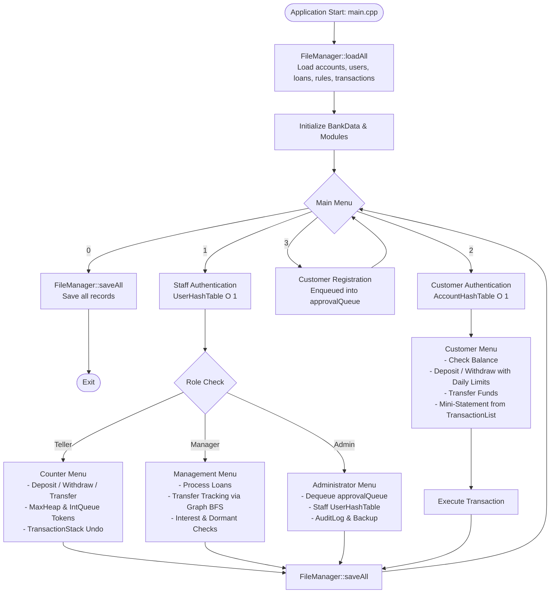

# 🏦 Enterprise Bank Management System (C++)

[](https://en.wikipedia.org/wiki/C%2B%2B11)
[-red.svg?style=flat-square)](https://github.com/)
[](https://github.com/)
[](https://github.com/)
[](LICENSE)

A high-performance, console-based **Bank Management System** developed in modern C++ (C++11). 

Built strictly **without the C++ Standard Template Library (STL)** containers or `std::string`, every foundational data structure—from self-balancing AVL Trees and Hash Tables to Heaps and Graphs—is engineered completely from scratch with direct dynamic memory management.

---

> ### 🎓 Academic Project Information
> - **University:** FAST NUCES
> - **Group Members:**
>   1. **Yash Raj** (25K-0878)
>   2. **Khunais Baig** (25K-0508)

---

## 📑 Table of Contents
- [✨ Key Highlights](#-key-highlights)
- [🧠 Data Structures & Complexity Analysis](#-data-structures--complexity-analysis)
- [🏛️ System Architecture](#️-system-architecture)
- [👥 Role-Based Access Control (RBAC)](#-role-based-access-control-rbac)
- [📂 Project Structure](#-project-structure)
- [⚙️ Building & Running](#️-building--running)
- [🚀 Quick Start Guide](#-quick-start-guide)
- [💾 Data Persistence & Safety](#-data-persistence--safety)
- [📄 Documentation](#-documentation)
- [👨‍💻 Project Team & University](#-project-team--university)

---

## ✨ Key Highlights

- **Zero STL Dependencies:** Completely free of `std::vector`, `std::string`, `std::map`, `std::queue`, or `std::stack`. Only `<iostream>`, `<fstream>`, `<cmath>`, and `<ctime>` are utilized.
- **Dual-Indexing Pattern:** Accounts are mirrored across a **Hash Table** (for $O(1)$ constant-time authentication and lookups) and a **Self-Balancing AVL Tree** (for $O(\log n)$ sorted in-order reporting).
- **Forensic Graph Tracking:** Implements an inter-account directed transaction graph using **Breadth-First Search (BFS)** for money laundering and multi-hop flow investigations.
- **Multi-Tier Priority Scheduling:** Service desk ticketing uses a **Binary Max-Heap** for VIP and urgent assistance tickets, gracefully falling back to a **FIFO Queue** for regular walk-in customers.
- **Transactional Safety & Reversals:** Employs a **Linked Stack (LIFO)** to power an instant single-step "Undo Transaction" feature for counter tellers.
- **Fault-Tolerant Persistence:** Binary and formatted data storage with automatic `backup_*` generation, data integrity verification, and corrupted record skipping.

---

## 🧠 Data Structures & Complexity Analysis

| Data Structure | Project Implementation | Primary Role in System | Time Complexity |
| :--- | :--- | :--- | :--- |
| **Hash Table** | `AccountHashTable`, `UserHashTable` | Instant account & staff credential lookup | **Average:** $O(1)$ / **Worst:** $O(n)$ |
| **AVL Tree** | `AccountAVLTree` | Strictly balanced account indexing & sorted reporting | **Guaranteed:** $O(\log n)$ search/insert |
| **Doubly Linked List**| `TransactionList` | Chronological account statement & mini-statement ledger | **Append:** $O(1)$ / **Last $k$ items:** $O(k)$ |
| **Linked Stack** | `TransactionStack` | Single-step "Undo Last Transaction" for tellers | **Push/Pop/Peek:** $O(1)$ |
| **Linked Queue** | `IntQueue` | FIFO regular customer ticketing & account approval queue | **Enqueue/Dequeue:** $O(1)$ |
| **Binary Max-Heap** | `MaxHeap` | Priority queue for VIP desk tokens & loan evaluation | **Top:** $O(1)$ / **Insert/Remove:** $O(\log n)$ |
| **Directed Graph** | `TransferGraph` | Inter-account money flow tracking & reachability (BFS) | **Traversal:** $O(V + E)$ |
| **Dynamic Array** | `DynamicArray<T>` | Generic, cache-friendly replacement for `std::vector` | **Random Access:** $O(1)$ / **Append:** $O(1)$ amortized |
| **Custom String** | `String` | Deep-copying, dynamic string engine replacing `std::string` | **Memory Safe:** Rule of Three |

---

## 🏛️ System Architecture



---

## 👥 Role-Based Access Control (RBAC)

### 1. 🧑‍💼 Customer
* **Balance & Limits:** Check real-time balance and track remaining daily withdrawal limits.
* **Transactions:** Deposit, withdraw, and transfer funds to other verified accounts.
* **Statements:** Generate 5-transaction mini-statements or complete chronological history.
* **Services:** Pay utility bills, update nominee details, apply for loans, and request account tier upgrades.

### 2. 👨‍💻 Counter Staff / Teller
* **Service Desk:** Issue priority/regular customer tokens and dispatch waiting customers.
* **Financial Operations:** Execute counter deposits, withdrawals, and account-to-account transfers.
* **Mistake Correction:** One-click rollback for mistaken deposits/withdrawals via the undo stack.

### 3. 👔 Branch Manager
* **Loan Engine:** Evaluate, approve, or reject loan applications.
* **Security Controls:** Freeze, unfreeze, or unlock customer accounts and reset lost customer PINs.
* **Analytics & Audits:** Detect dormant accounts, credit savings interest, view top depositors, and trace multi-hop money transfers.

### 4. 🛡️ System Administrator
* **Staff Provisioning:** Add, edit roles, reset passwords, or remove staff members.
* **Account Approvals:** Review and verify pending account creation requests.
* **Global Rules:** Adjust base interest rates, minimum balances, and daily withdrawal limits.
* **System Safeguards:** Inspect the immutable audit log and perform full database backups/restorations.

---

## 📂 Project Structure

```text
├── Account.h / .cpp           # Core account entity & daily limit logic
├── AccountAVLTree.h / .cpp    # Self-balancing AVL tree for sorted storage
├── AccountHashTable.h / .cpp  # Hash table for O(1) account lookup
├── AccountModule.h / .cpp     # Account creation, search, and update flows
├── AdminModule.h / .cpp       # System administration & staff management
├── AuditLog.h / .cpp          # Immutable system action audit trail
├── BankData.h / .cpp          # Centralized data repository & dual-indexing engine
├── DynamicArray.h / .cpp      # Generic templated resizable array (vector replacement)
├── FileManager.h / .cpp       # Binary/text persistence and automated backups
├── IntQueue.h / .cpp          # Linked FIFO queue for ticketing and approvals
├── LoanModule.h / .cpp        # Loan application and installment processing
├── LoginModule.h / .cpp       # Authentication & PIN verification module
├── MaxHeap.h / .cpp           # Binary Max-Heap priority queue
├── MenuModule.h / .cpp        # Console UI and multi-tier menu dispatcher
├── Models.h / .cpp            # Domain structs, enums, and constants
├── ReportModule.h / .cpp      # Reports, summaries, and graph analytics
├── ServiceQueueModule.h / .cpp# Token generation and priority service dispatch
├── String.h / .cpp            # Custom dynamic char-array string class
├── TransactionList.h / .cpp   # Doubly linked list for chronological statements
├── TransactionModule.h / .cpp # Financial processing & undo stack operations
├── TransactionStack.h / .cpp  # Linked LIFO stack for transaction reversal
├── TransferGraph.h / .cpp     # Directed weighted graph & BFS flow tracer
├── UserHashTable.h / .cpp     # Staff authentication hash table
├── Utility.h / .cpp           # Input validation, hashing, and formatting
├── Makefile                   # Automated build configuration
├── main.cpp                   # Application entry point
└── README.md                  # Project documentation
```

---

## ⚙️ Building & Running

### Prerequisites
* A C++ compiler supporting **C++11** or newer (`g++`, `clang++`, or `MSVC`).
* `make` (optional).

### Option 1: Using Makefile
```bash
# Compile
make

# Run
./BankManagementSystem
```

### Option 2: Using G++ directly
```bash
# Compile all source files with optimization and warning checks
g++ -std=c++11 -Wall -Wextra -O2 *.cpp -o BankManagementSystem

# Run on Windows
.\BankManagementSystem.exe

# Run on Linux / macOS
./BankManagementSystem
```

---

## 🚀 Quick Start Guide

1. **Launch the application** in your terminal.
2. **Default Administrator Credentials:**
   * **User ID:** `admin`
   * **Password:** `admin123`
3. **Registering a New Customer Account:**
   * Select `3. Open a new account` on the main screen and fill in the details.
   * Log into the **Staff Portal** as `admin`, navigate to `Approve new accounts`, and approve the pending application.
   * Once approved, the customer can log in using their new **Account Number** and **PIN**.

---

## 💾 Data Persistence & Safety

All system states are automatically saved to local flat files after every state-modifying action and during clean shutdown:

| File Name | Format | Description |
| :--- | :--- | :--- |
| `accounts.dat` | Binary | Customer accounts, balance, limits, and status |
| `transactions.dat` | Binary | Complete transaction ledger history |
| `loans.dat` | Binary | Active, pending, and cleared loan records |
| `users.dat` | Text | Staff accounts and hashed credentials |
| `requests.dat` | Text | Tier upgrade and account modification requests |
| `rules.dat` | Text | Configured bank rules, limits, and interest rates |
| `log.txt` | Text | Timestamped immutable audit log |
| `receipts.txt` | Text | Formatted transaction receipts generated for customers |

> **Automated Safety:** Before writing updates to disk, `FileManager` automatically creates `backup_<filename>` snapshots to guarantee zero data loss in the event of an unexpected crash or termination.

---

## 📄 Documentation

For an in-depth mathematical and structural explanation of every custom data structure and its memory layout, refer to the included [Bank_Management_System_DSA_Documentation.pdf](Bank_Management_System_DSA_Documentation.pdf).

---

## 👨‍💻 Project Team & University

- **University:** FAST NUCES (National University of Computer and Emerging Sciences)

### 👥 Group Members
| # | Name | Roll Number |
| :-: | :--- | :--- |
| 1 | **Yash Raj** | 25K-0878 |
| 2 | **Khunais Baig** | 25K-0508 |

---

## 📜 License
This project was developed for educational and academic purposes under the **MIT License**. Feel free to inspect, learn from, and adapt the custom data structures!
